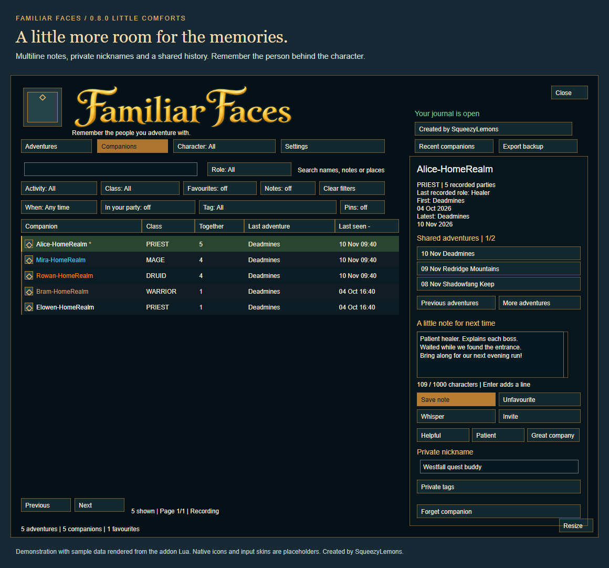

<p align="center">
  
</p>

<p align="center">
  <a href="#getting-started">Get started</a> ·
  <a href="#features">Features</a> ·
  <a href="#commands">Commands</a> ·
  <a href="https://github.com/fullstackprocrastinator/party-memory/issues">Report an issue</a>
</p>

<p align="center"><strong>WoW Forever 1.60.1</strong> · Version 0.8.0 · Little Comforts · MIT licensed · No addon dependencies</p>

---

## A great party shouldn't be forgotten

Maybe it was the healer who saved the run, the tank who explained the boss, or someone who made a long quest chain fun. **Familiar Faces** keeps a personal journal of your party companions, so you can find them again.

Join a party and the addon remembers who was there, when you played, and where you went. Add a note, mark a favourite, and pick up the adventure another day.

## Features

| | What you can do |
| :--- | :--- |
| **Remember your party** | Browse persistent history with player names, realms, dates, locations and dungeon difficulty. |
| **Keep the adventure together** | Entering or leaving a dungeon updates the same continuous party entry. Member changes retain everyone who joined. |
| **Find familiar faces** | Search by player, your character, location or personal note; filter dungeon groups, questing groups and favourites. |
| **Make it personal** | Keep notes and favourites for each player, shared across your characters in the same account/client. |
| **Reconnect** | Select a player to open a whisper or send an invitation through the game's normal social functions. |
| **Read at a glance** | Class-coloured names, with pages for previous players and visited locations. |
| **Recognise a reunion** | Optional chat notices recall your previous adventure and note, once per companion per party. |
| **Remember where you met** | See each companion's last adventure and keep favourites at the top. |
| **Quick personal notes** | Add Helpful, Patient or Great company to your note draft, then save it. |
| **Choose what to keep** | Forget individual adventures or companions with confirmation and updated encounter counts. |
| **Make it yours** | Save private searchable nicknames, restore your window placement and open the journal from an optional minimap button. |
| **Protect your notes** | Save, discard or cancel unsaved changes; roster updates preserve your draft. |
| **Find recent company** | Filter the last 7 or 30 days and highlight current party members. |
| **Remember the story** | Write adventure notes, pin memorable runs and view how you first met a companion. |
| **Organise your company** | Tag helpful guides, quest buddies and people to run with again; open everyone from your latest party. |
| **Keep a backup** | Export a private archive, preview imports and merge memories or explicitly replace your journal. Current settings stay unchanged on import. |
| **Recognise someone on hover** | Optional player tooltip reminders show shared adventures, the last meeting and favourite status; private notes are separately opt-in. |
| **Remember a run while it is fresh** | Optional end-of-adventure recaps provide favourite and note shortcuts, deferred during combat and loading. |
| **Continue after a reload** | Recover the same character's exact party within five minutes of the last saved checkpoint, excluding time away. |
| **Use your own words** | Create up to 20 private custom tags, rename them and remove them with confirmation. |
| **Choose your character** | Filter adventures and companions by your recorded characters; companion profiles remain shared. |
| **Settle in** | Manage preferences together in Settings or with `/ff settings`. |
| **Remember your view** | Restore your tab, search, filters and sort across logins; reset the view whenever you like. |
| **Give notes more room** | Save multiline notes up to 1,000 characters, with a counter and scrollable editor. |
| **Remember their role** | See recorded Tank, Healer, Damage or Unknown roles. Filter past adventures or a companion's latest recorded role. |
| **Browse comfortably** | Mouse-wheel paging and indexed history lookups help you explore a growing journal. |

### Two ways to explore your journal

**Adventures** shows a sortable table of parties: date, activity, location, companions and duration. **Companions** shows unique players: class-coloured name, class, times together, last adventure and last seen. Select a companion to browse every adventure you shared; click an adventure to return to its party details.

Use selectable menus for activity, class, character, date, tags and historical role, toggle favourites or notes-only, and click column headings to sort. Hover a row to see its full note or party members. Open **Settings** for recording, favourites-first sorting, reunion notices, tooltip reminders, recaps and minimap visibility. Recaps and private tooltip notes start off. The teal journal uses a stylised gold wordmark, alternating rows and selected-row highlighting. Drag the bottom-right **Resize** control to resize the window.



*Demonstration rendered from the addon Lua with fictional data; native game icons and input skins are placeholders.*

See the [complete addon description](docs/DESCRIPTION.md) and [changelog](CHANGELOG.md).

## Getting started

### Download

[Download Familiar Faces 0.8.0 for WoW Forever](downloads/FamiliarFaces-0.8.0-Forever.zip?raw=true). This is the install ZIP. Other client packages are available from [Test and package workflow runs](https://github.com/fullstackprocrastinator/party-memory/actions/workflows/ci.yml).

### Install

1. Close WoW.
2. Extract the ZIP and put the **`FamiliarFaces`** folder in **`_forever_/Interface/AddOns`** under your World of Warcraft installation.
3. Restart the game and enable **Familiar Faces** in the character-selection AddOns menu.
4. Log in, type **`/ff`**, and join a party. Recording starts automatically; allow up to 15 seconds for the next periodic capture.

**Moving from the beta?** The live install has its own saved settings. To bring your beta journal over, close both clients, back up any live `FamiliarFaces.lua` in `_forever_/WTF/Account/<account>/SavedVariables/`, and copy the beta's `FamiliarFaces.lua` from the corresponding `_classic_beta_` directory into that live SavedVariables folder. This replaces the live journal rather than merging it. Skip this step to start fresh.

```text
Interface/
└── AddOns/
    └── FamiliarFaces/
        ├── FamiliarFaces.toc
        ├── Core.lua
        ├── Store.lua
        ├── Backup.lua
        ├── Tooltips.lua
        └── UI.lua
```

**Upgrading from a Party Memory test build?** Close WoW, remove the old `PartyMemory` addon folder from `Interface/AddOns`, and install `FamiliarFaces` instead. The new addon uses its own saved-data name and starts with fresh history; old test history is not imported. Keep only one addon copy installed. Future Familiar Faces updates can replace files inside the existing `FamiliarFaces` folder.

### Use it

Select an adventure to browse its companions and location timeline, or open **Companions** to find a player directly. The detail panel links players and shared adventures and provides notes, favourites, whisper and invite actions. Use its paging controls to explore longer histories. Invitations and whispers remain subject to the game's permissions, online status and cross-realm restrictions.

## Commands

| Command | Action |
| :--- | :--- |
| `/ff` or `/familiarfaces` | Open or close the window. |
| `/ff settings` | Open journal preferences. |
| `/ff pause` | Pause recording. |
| `/ff resume` | Resume recording. |
| `/ff notices` | Toggle reunion chat notices. |
| `/ff minimap` | Show or hide the minimap button. |
| `/ff reset window` | Reset window size and position. |
| `/ff export` | Open the journal text backup. |
| `/ff import` | Preview and merge or replace a journal from a text backup. |
| `/ff reset view` | Open Adventures and clear search and filters. |
| `/ff clear` | Show instructions for clearing saved data. |
| `/ff clear confirm` | Erase all saved history, notes and favourites. |

The older `/pm` and `/partymemory` commands still work.

## How party history works

- **One continuous party, one entry.** Members and locations can change without creating another entry.
- **Dungeon visits stay remembered.** Once the party enters a dungeon, the entry keeps the latest dungeon name even after returning outdoors.
- **Outdoor-only parties stay Questing.** This label describes an outdoor group; it does not verify quest completion.
- **Leaving or disbanding ends the entry.** The next party starts another. Pausing/resuming recording starts a fresh entry too.
- **Short reloads can resume the entry.** The same character and exact roster must return within five minutes of the last saved checkpoint. Time away is excluded, and reunion notices are preserved. Changed or expired checkpoints start another adventure. An identical party re-formed while offline cannot always be distinguished; crash recovery is limited to the state WoW last saved.
- **Earlier records stay intact.** Old duplicates are preserved because earlier versions did not record enough information to safely merge them.

Raid, arena and battleground groups are excluded. History begins when the addon is installed; previous adventures cannot be recovered. Capture waits for unknown or restricted player information and defers unit reads during combat, so very brief parties may be missed. Player encounter counts describe recorded entries, rather than completed dungeons.

## Your journal stays local

Familiar Faces includes **no chat logging, telemetry or automatic data sharing**. It stores character names, realms, group dates, locations, your notes and favourites locally in WoW's account SavedVariables.

WoW writes this data on normal logout or reload. To back it up, copy:

```text
WTF/Account/<account>/SavedVariables/FamiliarFaces.lua
```

Keep that file private when reporting bugs. The distribution ZIP contains code and the license, not your personal history. History stays until you clear it. Shared history indexing reduces repeated lookups; very large journals can still use more memory. Text imports accept archives up to 2 MB, 10,000 adventures and 25,000 profiles, with at most 20 custom tags after merging. Use `/ff import` while solo and outside combat. Existing text wins merge conflicts; settings are kept in both modes. Pasted backups are parsed as data, never executed as Lua.

## Compatibility

| Package | Target | Validation |
| :--- | :--- | :--- |
| **Forever** | WoW Forever 1.60.1 · interface `16001` | Earlier UI loading and party recording observed in-game; 0.8.0 has automated coverage and still needs live-client checks. |
| Retail | Interface `120007` | Packaging target; not yet verified in-game. |
| 335 | Legacy 3.3.5 · interface `30300` | Packaging target; not yet verified in-game. |

Use the Forever package for WoW Forever. Do not assume compatibility with a different client just because its package builds successfully.

## Development

The addon uses Lua with no bundled libraries. Build install ZIPs using PowerShell:

```powershell
./scripts/package.ps1                 # WoW Forever (default)
./scripts/package.ps1 -Client Retail
./scripts/package.ps1 -Client 335
```

Packages are written to `dist/`, with the addon folder at the ZIP root.

Run the automated Lua 5.1 tests through Python:

```shell
python -m pip install lupa==2.8
python tests/test_addon.py
```

Tests cover party continuity, member replacements, location history, saved data, filters, legacy API fallbacks and UI interactions with mocked WoW APIs. For this update, use the [0.8.0 in-game checklist](docs/TESTING-0.8.0.md). For publishing, see the [CurseForge guide](docs/CURSEFORGE.md).

## Feedback and license

Found a problem? [Open an issue](https://github.com/fullstackprocrastinator/party-memory/issues) with your client version, steps to reproduce it and any Lua error text. Please omit account details and personal SavedVariables.

Familiar Faces is released under the [MIT License](LICENSE).

---

<p align="center"><em>Good company is worth remembering.</em></p>
